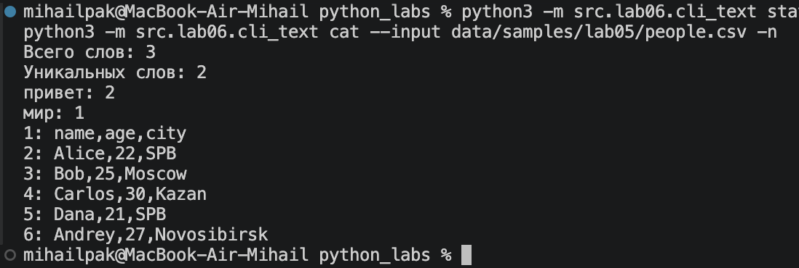
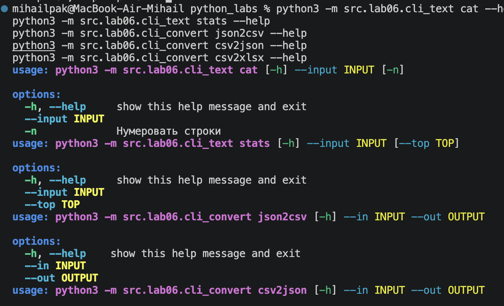

# CLI‑утилиты с argparse (cat/grep‑lite + конвертеры):
### Утилиты
#### cli_text
- stats --> stats --input <путь> [--top N] (считает слова, выводит Топ-N)
- cat --input <path> [-n] — вывод содержимого файла построчно (с нумерацией при -n)
```python
import argparse
from pathlib import Path
from src.lib.text import normalize, tokenize, count_freq, top_n

def main():
    parser = argparse.ArgumentParser(description="CLI‑утилиты лабораторной №6")
    subparsers = parser.add_subparsers(dest="command" ,required=True)

    # подкоманда cat
    cat_parser = subparsers.add_parser("cat", help="Вывести содержимое файла")
    cat_parser.add_argument("--input", required=True)
    cat_parser.add_argument("-n", action="store_true", help="Нумеровать строки")

    # подкоманда stats
    stats_parser = subparsers.add_parser("stats", help="Частоты слов")
    stats_parser.add_argument("--input", required=True)
    stats_parser.add_argument("--top", type=int, default=5)

    args = parser.parse_args()

    if args.command == "cat":
         path = Path(args.input)
         with path.open(encoding="utf-8") as file:
            for number, line in enumerate(file, start=1):
                if args.n:
                    print(f"{number}: {line}", end="")
                else:
                    print(line, end="")
    elif args.command == "stats":
         if args.top < 1:
            stats_parser.error("--top должен быть положительным целым числом")
         text = path.read_text(encoding="utf-8")
         words = tokenize(normalize(text))
         frequencies = count_freq(words)

         print(f"Всего слов: {len(words)}")
         print(f"Уникальных слов: {len(frequencies)}")

         for word, count in top_n(frequencies, args.top):
            print(f"{word}: {count}")
```
#### cli_convert
- json2csv --in data/samples/people.json --out data/out/people.csv
- csv2json --in data/samples/people.csv --out data/out/people.json
- csv2xlsx --in data/samples/people.csv --out data/out/people.xlsx
```python
import argparse
from src.lab05.json_csv import json_to_csv, csv_to_json
from src.lab05.csv_xlsx import csv_to_xlsx

def main():
    parser = argparse.ArgumentParser(description="Конвертеры данных")
    sub = parser.add_subparsers(dest="cmd",required=True)

    p1 = sub.add_parser("json2csv")
    p1.add_argument("--in", dest="input", required=True)
    p1.add_argument("--out", dest="output", required=True)

    p2 = sub.add_parser("csv2json")
    p2.add_argument("--in", dest="input", required=True)
    p2.add_argument("--out", dest="output", required=True)

    p3 = sub.add_parser("csv2xlsx")
    p3.add_argument("--in", dest="input", required=True)
    p3.add_argument("--out", dest="output", required=True)

    args = parser.parse_args()
    
    if args.cmd == "json2csv":
        json_to_csv(args.input, args.output)
    elif args.cmd == "csv2json":
        csv_to_json(args.input, args.output)
    elif args.cmd == "csv2xlsx":
        csv_to_xlsx(args.input, args.output)        
```
#### команды запуска(примеры)
- python3 -m src.lab06.cli_text cat --help
- python3 -m src.lab06.cli_convert json2csv --in data/samples/lab05/people.json --out data/out/lab06/people.csv
- python3 -m src.lab06.cli_convert csv2json --in data/samples/lab05/people.csv --out data/out/lab06/people.json
- python3 -m src.lab06.cli_convert csv2xlsx --in data/samples/lab05/people.csv --out data/out/lab06/people.xlsx
- python3 -m src.lab06.cli_text stats --input data/samples/lab04/input.txt --top 5
- python3 -m src.lab06.cli_text cat --input data/samples/lab05/people.csv -n
### примеры вывода

